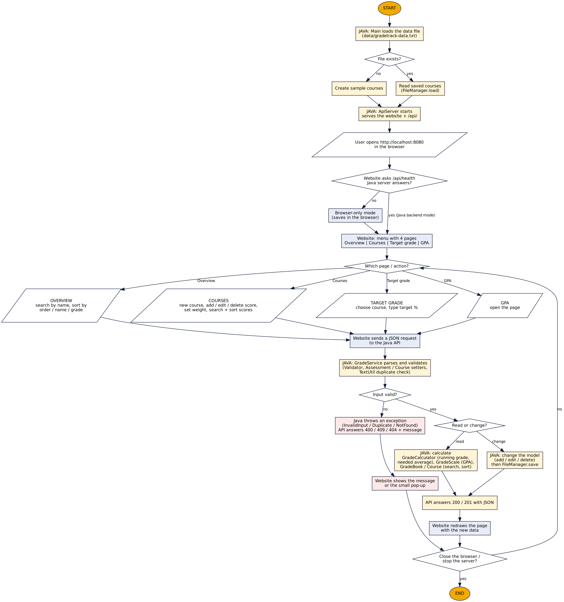

# GradeTrack - Project Documentation

## 1. Project Title
**GradeTrack: A Web-Based Grade Tracker with a Modular Java Backend for Course Grades, Target Grades and GPA**

## 2. Project Overview
Students usually write their quiz, test, examination and laboratory scores in different places and then
calculate by hand what they still need to pass or to reach a target. GradeTrack puts this in one website.
A student records each course with its credits, sets the weight of every activity category, and enters
scores as they are graded. The system then shows the current grade of every course, tells the student what
average is needed on the remaining work to reach a target final grade, and computes the GPA weighted by credits.

The system has two parts:

- **The website** (HTML, CSS and JavaScript) is what the user sees: the menu, the forms and the results.
- **The Java backend** is the brain of the system. It is a Java program built with an object-oriented,
  modular design. It validates every input, performs every calculation (running grade, needed average,
  GPA), searches and sorts the records, handles errors with exceptions, and saves all data in a file.
  It also serves the website, so the whole system starts with one command.

The two parts talk through a small JSON API (`/api/...`). Java packages: `model` (the data), `logic`
(calculations and validation), `service` (the operations the website can ask for), `server` (HTTP and JSON),
`storage` (file handling) and `exception` (error types).

**Target users:** college students who want to monitor their grades during the semester.

**Main modules:** Overview, Courses, Target Grade, GPA.

## 3. Project Objectives
1. To apply the Java programming concepts learned in OOP101 in a complete, working application.
2. To demonstrate classes and objects, constructors, encapsulation, inheritance, polymorphism and
   abstraction through the grade-tracking model (`Assessment` and its subclasses, `Course`, `GradeBook`).
3. To divide the system into organized modules and classes, each with a specific responsibility
   (model, logic, service, server, storage, exception).
4. To use methods, collections (`ArrayList`, `LinkedHashMap`, `HashMap`), searching and sorting, exception
   handling and file handling to make the system reliable.
5. To provide a simple and user-friendly interface (a website with a clear menu and messages) that is
   connected to a Java backend.
6. To validate user input in Java (for example, the target grade must be at least 75, a score cannot be higher
   than its total, and an activity type that already exists cannot be added again).
7. To practice problem solving and teamwork in planning, coding, testing, documenting and presenting.

## 4. Scope and Limitations

**Scope**
- Add, view, update and delete courses, scores and category weights.
- Built-in activity types (Quiz, Test, Examination, Laboratory) plus any type typed by the student through
  "Other (specify)", with a pop-up when the typed type already exists (even with a small typo).
- Running grade per course, the average needed on the remaining work, and the credit-weighted GPA.
- Search and sort of courses (by name or grade) and of scores (by name, type or score).
- Automatic saving and loading from a text file by the Java backend.
- Input validation with clear messages; target grades below 75 are refused with a pop-up.
- Automatic self-test of the Java code and of the API (`run-tests`).

**Limitations**
- Single user on one computer; no login and no online sync between devices.
- Data is stored in a plain text file, not in a database (MySQL/SQLite is optional in the project sheet).
- The Java server must be running to use the Java features. Without it, the website still opens and works
  by itself in the browser (a fallback), but then the calculations are done by JavaScript and the data is
  saved in the browser, not in the Java data file.
- Uses one fixed grading scale (1.00 to 5.00, passing mark 75). Another scale needs a code change in `GradeScale`.
- A new custom activity type starts with 0% weight; the student must set its weight, and the weights should
  add up to 100%.
- The target grade must be between 75 and 100.
- The needed-average result assumes the remaining work will be graded with the current category weights.

## 5. System Flowchart

(Editable source: `backend/docs/system-flowchart.dot`. The package diagram is `backend/docs/architecture.png`.)

## 6. Class Design (summary)

| Package | Class | Responsibility |
|---|---|---|
| model | `Assessment` (abstract) | One graded item: id, name, score (or not graded), total; validation; static factory `create` |
| model | `Quiz`, `Test`, `Examination`, `Laboratory`, `CustomActivity` | Kinds of assessment; each returns its own category |
| model | `Course` | Credits, category weights, list of assessments, totals per category, search and sort of scores |
| model | `GradeBook` | All courses; add, remove, find, search, sort, load, save |
| logic | `GradeCalculator` | Running grade and needed average |
| logic | `GradeScale` | Percent to grade, description and GPA |
| logic | `Validator`, `TextUtil` | Number parsing, text cleaning and the "already exists" check |
| service | `GradeService` | Every operation the website can request: validate, calculate, change, save |
| server | `ApiServer` | Built-in Java HTTP server: serves the website files and routes `/api/` calls |
| server | `Json` | Small JSON reader and writer (no outside library) |
| storage | `FileManager` | Writes and reads the data file |
| exception | `InvalidInputException`, `DuplicateEntryException`, `TargetTooLowException`, `NotFoundException` | Error types with user-ready messages |
| (root) | `Main`, `SelfTest` | Starts the system; automatic checks |

## 7. OOP Concepts Used (for the defense)
- **Encapsulation:** `Assessment` and `Course` keep fields private and change them only through setters that validate.
- **Inheritance:** five subclasses of `Assessment`; `DuplicateEntryException` and `TargetTooLowException` extend `InvalidInputException`.
- **Abstraction:** `Assessment.getCategory()` is abstract; `GradeService` hides all the rules behind simple methods.
- **Polymorphism:** a list of `Assessment` objects is handled the same way, but each answers `getCategory()` differently.
- **Overloading:** two `addAssessment` methods, two `Course` constructors, two constructors per built-in type.
- **Static members:** `GradeScale`, `GradeCalculator`, `Assessment.create`, `Course.BUILT_IN`, and the static id counters.
- **Collections:** `ArrayList` (courses, scores), `LinkedHashMap` (weights, JSON objects), `HashMap` (query values).
- **Searching and sorting:** `GradeBook.search`, `Course.searchItems` (with `Comparator`).
- **Exception handling:** custom checked exceptions, `throws` on constructors, setters and service methods;
  `try-catch` in `ApiServer` that turns each exception into a clear message (409 before 400 because of inheritance);
  `finally` in `FileManager.load`; try-with-resources in `FileManager.save`.
- **File handling:** `FileManager` (`data/gradetrack-data.txt`).
- **Input validation:** in Java (`Validator`, setters); the messages are shown by the website as-is.

## 8. Project Sheet Checklist

| Requirement | Where |
|---|---|
| Main menu / navigation | Website menu: Overview, Courses, Target grade, GPA |
| Add, view, update, delete | Courses page (courses, scores, weights); `GradeService` |
| Searching and/or sorting | Overview and Courses pages; `GradeBook.search`, `Course.searchItems` |
| Calculations / processes | `GradeCalculator`, `GradeScale` |
| Validation and invalid input | `Validator`, setters, `GradeService`; messages and pop-ups in the website |
| Classes, constructors, `this`, access modifiers, encapsulation | `model` package |
| Inheritance, polymorphism, abstraction | `Assessment` family, exception family |
| Method overloading, static and instance members | `Course.addAssessment`, constructors, `GradeScale` |
| Arrays / Collections | `ArrayList`, `LinkedHashMap`, `HashMap` |
| File reading and writing | `FileManager` |
| try-catch, finally, throw, throws | `FileManager`, `ApiServer`, model setters |
| User interface | Website (see README, note about instructor approval) |
| Database (optional) | Not used |
